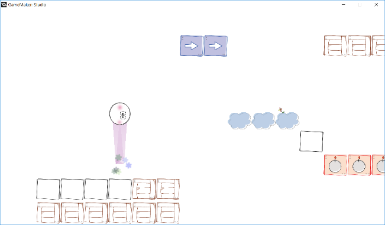

# Sketch Ball

[English](README.md)

게임메이커: 스튜디오로 만든 게임이다. 연필로 그린 듯한 블록 사이를 공이 통통 튀며 나아간다. 화면 왼쪽이나 오른쪽을 누르고 있으면 공이 그쪽으로 굴러가고 벽이나 상자에 닿으면 저절로 튀어 오른다. 나무 상자, 화살표, 구름, 폭탄, 함정 블록이 저마다 다르게 반응한다.

<p>
  
</p>


## 플레이 방법

Releases에서 받아 압축을 풀고 실행하면 된다. 마우스 왼쪽 버튼이나 터치로 조작한다.

| 입력 | 동작 |
|---|---|
| 화면 오른쪽 절반을 누르고 있기 | 오른쪽으로 가속 |
| 화면 왼쪽 절반을 누르고 있기 | 왼쪽으로 가속 |
| 손 떼기 | 천천히 멈춤 |

| 블록 | 공이 닿으면 |
|---|---|
| 벽 | 위아래 반대 방향으로 튕긴다 |
| 나무 상자 | 벽처럼 튕기고 위에서 내려앉았으면 상자가 부서진다 |
| 화살표 | 화살표 자리로 옮겨져 화살표 방향으로 빠르게 날아간다. 화면을 누르거나 다른 블록에 닿을 때까지 중력이 꺼진다 |
| 구름 | 위에서 내려앉으면 튀어 오르고 구름이 흐려져 잠시 통과할 수 있다. 아래에서 부딪히면 더 높이 솟는다 |
| 폭탄, 함정 | 공이 터진다 |


## 구현 원리

**충돌은 다음 위치를 미리 보고 블록 종류로 나눈다.** 공은 게임메이커의 물리 엔진 대신 `hspeed`, `vspeed`, `gravity` 로 움직인다. 매 스텝 지금 속도로 한 스텝 뒤의 자리에 블록이 있는지 `instance_place` 로 확인하고 닿을 블록의 `object_index` 에 따라 속도를 바꾼다. 튕길 때마다 공이 도는 방향도 뒤집는다.

```gml
var ins = instance_place(x+hspeed, y+vspeed, par_block);
if(ins!=noone)
{
    angle_plus *= -1
    switch(ins.object_index)
    {
        case obj_wall:
            hspeed = 0
            vspeed = -vspeed_jump*sign(vspeed)
            scr_ball_gravity_use(true)
            scr_particle_collision()
            break
        ...
    }
}
```

공 뒤의 보라색 궤적은 지난 위치를 `ds_grid` 에 쌓아 두고 그 점들을 따라 폭이 줄어드는 삼각형 띠(`pr_trianglestrip`)로 그린다.


## 파일

| 경로 | 내용 |
|---|---|
| `source/SketchBall.project.gmx` | 게임메이커: 스튜디오 프로젝트 파일 |
| `source/objects/` | 공, 블록, 게임 관리, 배경음 오브젝트 |
| `source/scripts/` | 가속, 중력, 파티클, 궤적 스크립트 |
| `source/rooms/room_game.room.gmx` | 게임 룸 |
| `source/sprites/`, `source/sound/` | 그림, 배경음 |
| `source/extensions/Draw Trail/` | Draw Trail 확장 |
| `docs/screenshots/` | 스크린샷 |
| Releases | 실행 파일과 런타임 |


## 크레딧

궤적 스크립트(`source/scripts/trail_*.gml`, `draw_trail_ext.gml`)는 Allan Gustavo Miranda Espinoa 가 만든 Draw Trail 확장을 고쳐 쓴 것이다.


## 라이선스

CC BY-NC-ND 4.0 라이선스다. 출처를 밝히면 비상업 용도로 그대로 공유할 수 있고, 수정본 배포와 상업적 이용은 금지한다. 함께 들어 있는 것 중 다른 사람이 만든 라이브러리와 그림·소리·맵은 각자의 권리를 따른다. 자세한 내용은 [LICENSE](LICENSE) 에 있다.
